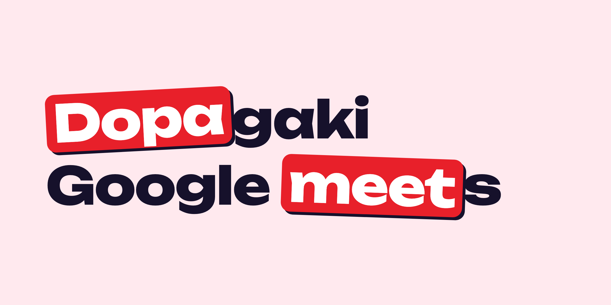
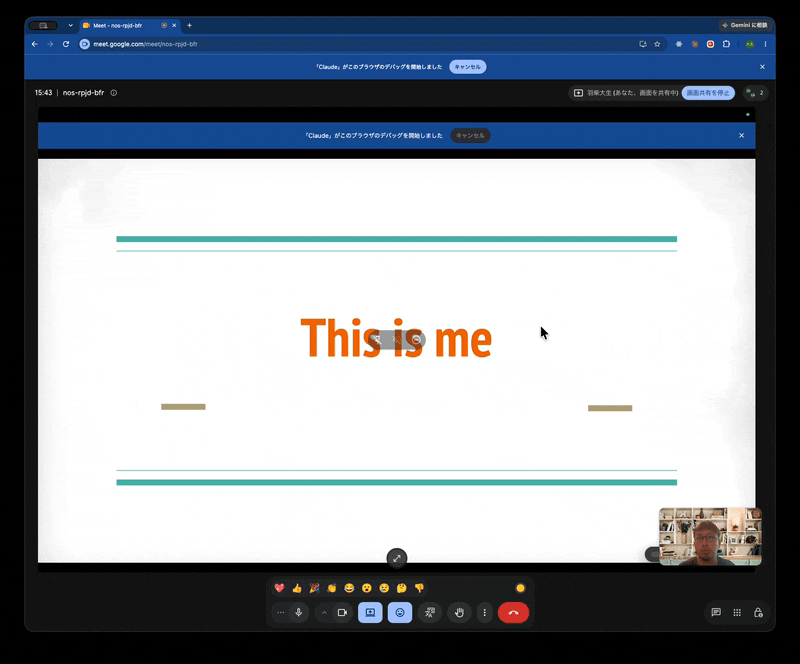
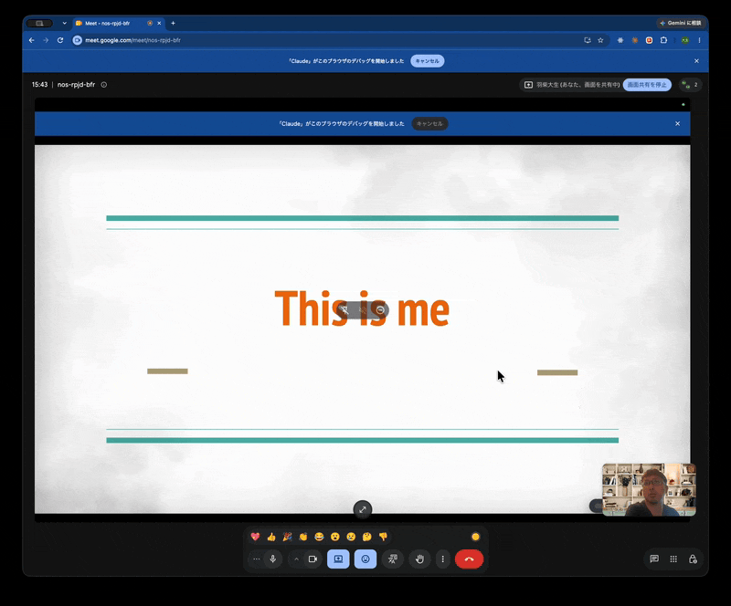

# Dopameet



| 盛り上がる | 盛り下がる |
|---|---|
|  |  |

## MTGで発表していてリアクションが少なく、悲しい気持ちになったことありませんか？？

Dopameet は Google Meet のリアクションに合わせて、発表中の画面を盛り上げたり暗くしたりする Chrome 拡張です。
「みんなちゃんとリアクションしよう！」がコンセプトで、リアクションが止まると画面が暗くなっていきます。

- 通話に入るとテンション 0 から始まり、何も来なければ 1 秒に 1 ずつ下がり続けます。最低（-100）まで下がると END
- 良いリアクション（💖👍🎉👏😂😮）1 回で +8、👎 1 回で -12
- テンションが 85 以上のあいだはレインボー
- 通話を抜けると 0 に戻ります。通話の外では、何も来なければ 25 秒ごとに半分ずつ 0 に戻ります

演出は、ポップアップの「このタブに演出を出す」を押したタブに出ます。そのタブを Meet で共有すれば、参加者全員に見えます。
そのタブで別のページに移ったり再読み込みしたりすると演出は消えるので、もう一度押してください。

## 演出

| テンション | 演出 |
|---|---|
| ふつう | 何も出ない |
| 盛り上がる | 画面の縁から煙が渦を巻いて流れ込み、青 → 水色 → 緑 → 赤 と色が上がる。色が上がる瞬間に光る |
| 85 以上 | 虹色の煙が噴き出す（レインボー） |
| 盛り下がる | 画面全体が薄暗くなり、黒い煙が縁から中心へ狭まっていく |
| 最低 | 真っ暗になって END と出る |

## メモリ

共有している画面の右下に、いまのテンションをバーで出します。色は煙の段階と同じで、レインボーのあいだは虹色になります。
参加者に「押すと画面が変わる」ことが伝わるようにするためです。

表示のしかたはポップアップで選べます。

- Meet の通話中だけ表示（初期設定）
- 常に表示
- 表示しない

## 停止

ポップアップ右上の「停止」を押すと、演出を出しているすべてのタブから演出とメモリが消えます。
停止しているあいだはテンションも止まり、リアクションを数えず、時間がたっても上下しません。
「再開」を押すと、止めたときの値から続きが動きます。

## インストール

```sh
pnpm install
pnpm build
```

1. Chrome で `chrome://extensions` を開く
2. 右上の「デベロッパー モード」をオンにする
3. 「パッケージ化されていない拡張機能を読み込む」で、このリポジトリの `dist` フォルダを選ぶ
4. すでに開いているタブは再読み込みする

## 開発

| コマンド | 内容 |
|---|---|
| `pnpm dev` | ファイルを保存するたびに `dist` を作り直す |
| `pnpm play` | 演出だけを試すページを `http://localhost:8000` で開く |
| `pnpm build` | `dist` を作る |
| `pnpm typecheck` | 型チェック |
| `pnpm test` | テンション計算のテスト（`test/`） |
| `pnpm zip` | Chrome Web Store に提出する ZIP を作る |
| `pnpm store:images` | ストア用のスクリーンショットとプロモーション タイルを作る |

Chrome Web Store への提出手順と掲載文は [`store/README.md`](store/README.md) にまとめています。

コードを変えたら、`chrome://extensions` で拡張を再読み込みし、演出を出すタブも再読み込みしてください。

## 演出だけを試す

`pnpm play` を実行して `http://localhost:8000` を開くと、拡張を読み込まなくても演出を試せます。
上半分がダミーのスライドで、下のボタンを押すと拡張と同じ処理で演出が出ます。
`src/` のファイルを保存すると自動で再読み込みされます。

- `1`〜`7` キーでリアクション、`r` でリセット
- `↑` / `↓` キーか「最大」「最低」ボタンで、テンションを端に飛ばして戻り方を見られる
- 下がる速さや加点・減点、レインボーになるテンションをスライダーで変えられる
- 「通話中」のチェックを外すと、通話外の動き（0 に戻る）を試せる
- 背景は スライド / 白 / 黒 / カラフル から選べる
- メーター、背景、スライダーの値はブラウザに残る

ポート番号は `PORT=8001 pnpm play` のように変えられます。

## 動作確認

ポップアップの「このタブに演出を出す」を押してからテスト用ボタンを押すと、Meet に入らなくても演出を確かめられます。
`http` / `https` のページにだけ演出を出せます。Meet のタブにも出せません。`file://` のページや Chrome の PDF 表示には出ません。

## 構成

| ファイル | 役割 |
|---|---|
| `src/mood.ts` | テンションの計算と、`chrome.storage.local` を介したタブ間の共有 |
| `src/meet.ts` | Meet の画面に追加された絵文字を監視してリアクションを数える。通話中であることも知らせる |
| `src/engine.ts` | Canvas に描く演出の土台（パーティクル、フラッシュ、バネの動き） |
| `src/meter.ts` | 画面右下のメモリ |
| `src/fx.ts` | 演出から使う描画の部品 |
| `src/themes/normal.ts` | 演出の中身（煙の色の段階、暗転、END） |
| `src/stage.ts` | 画面に演出を重ねる層を作り、テンションや設定の変化を演出に反映する |
| `src/overlay.ts` | ポップアップから入れられたタブで、`chrome.storage` の変化を `stage` に渡す。同じタブに 2 回入らないようにする |
| `src/play/`, `play/` | 演出を試すページ（`pnpm play`）と、ストア用スクリーンショットの撮影ページ |
| `store/` | Chrome Web Store の掲載文、プロモーション タイルの元データ、提出用画像 |
| `src/popup.ts` | ポップアップ。開いているタブに `chrome.scripting` で `overlay.ts` を入れる |
| `public/` | `manifest.json` やポップアップの HTML など、そのまま `dist` に写すファイル |
| `assets/` | アイコンとヒーロー画像の元データ（`icon.svg`、`hero.html`）と、README に載せる画像 |

加点や下がる速さ、レインボーになるテンションは `src/mood.ts` の `DEFAULT_TUNING` で変えられます。
`pnpm play` のスライダーで値を試してから、ここに書き写すと楽です。
色が上がるテンションの境目は `src/themes/normal.ts` の `STAGES` で変えられます。

## 制約

- Meet にはリアクションを取得する公式 API がないため、画面の構造から推測して検知しています。Meet の UI が変わると検知できなくなることがあります
- 検知したリアクションは、Meet のタブの DevTools コンソールに `[dopameet] reaction` として出ます
- Chrome の外のアプリ（Keynote など）には演出を出せません
- OS で「視差効果を減らす」をオンにしていると、演出の量を減らします
